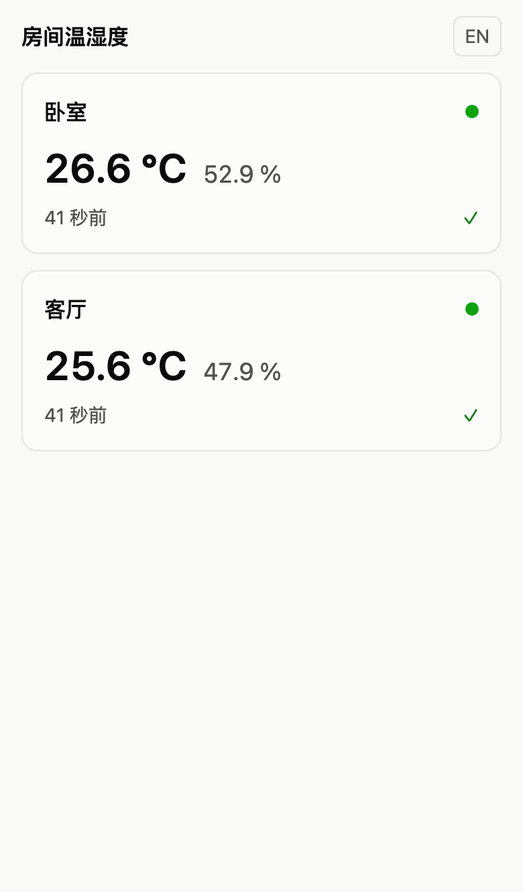
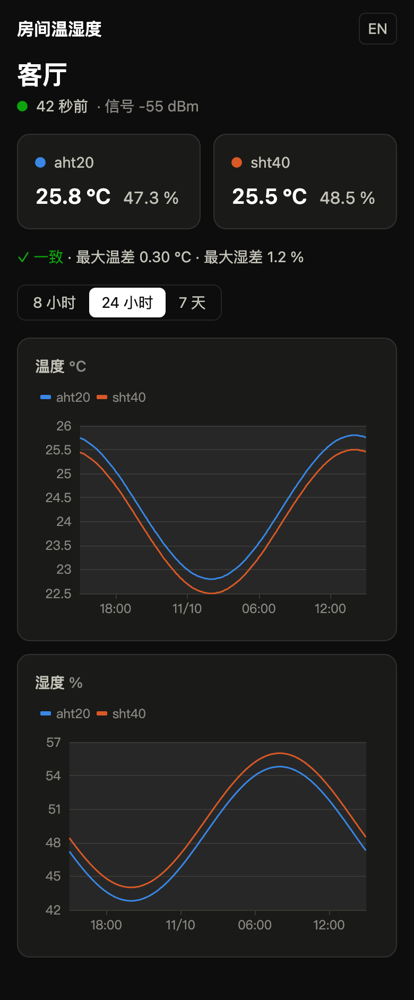
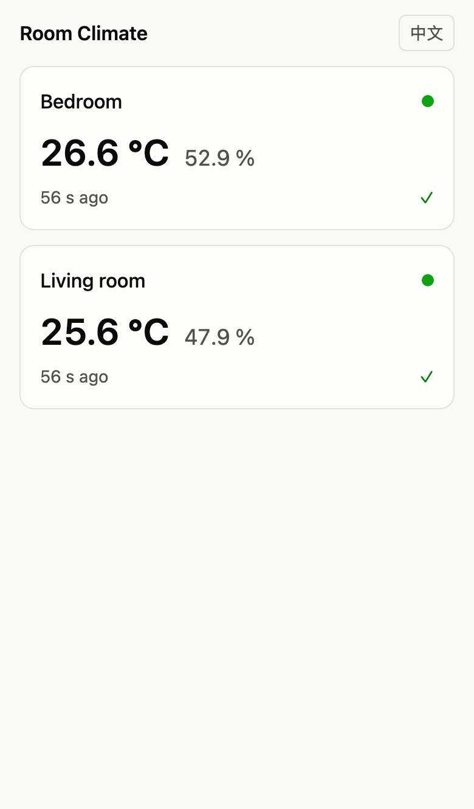
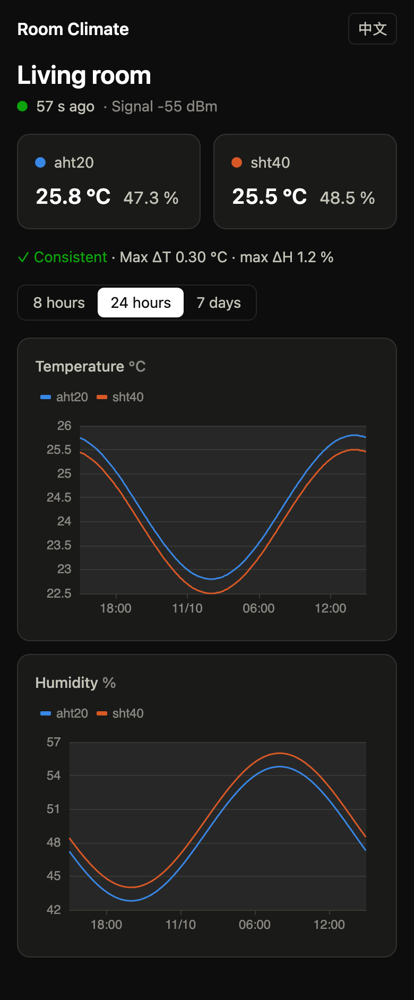

# room-climate-monitor

[中文](#中文) · [English](#english)

---

## 中文

一个自托管的家庭房间温湿度监控。每个房间放一块 ESP32 开发板，接 1~4 个温湿度传感器，通过局域网把读数上报给服务端；家里人用手机浏览器查看各房间的实时读数和历史曲线。

**在线 demo（模拟数据）**：https://lyu-huiyang.github.io/room-climate-monitor/

- **服务端**：Python 3.14 + FastAPI + SQLite，一个容器、一个端口，同时提供上报接口、查询接口和网页。
- **网页**：React，可安装到手机桌面（PWA），支持深色模式和中英文切换。
- **命令行 `rcm`**：注册房间、修改名称和舒适区间、更换设备密钥、备份。
- **硬件和固件**：ESP32-C3 SuperMini + SHT40 / AHT20，接线、配置和烧录见 [firmware/README.md](firmware/README.md)。

<p>
  
  
</p>

### 快速开始（Docker Compose）

```bash
git clone https://github.com/lyu-huiyang/room-climate-monitor.git
cd room-climate-monitor/deploy
mkdir -p data && sudo chown 10001:10001 data   # 容器以 uid 10001 运行
docker compose up -d --build
curl http://127.0.0.1:8080/api/health
```

浏览器打开 `http://127.0.0.1:8080` 就能看到网页。还没有房间时，页面会提示注册房间的命令。

- **数据目录**：必须让 uid 10001 可写。忘了 `chown` 时容器会反复重启，`docker compose logs app` 会提示原因；也可以改用命名卷，见 `deploy/compose.yaml` 里的注释。
- **局域网上报**：默认只监听 `127.0.0.1:8080`，局域网里的板子连不上。在 `deploy/compose.yaml` 里取消注释服务器局域网地址那一行（例如 `192.168.1.10:8080:8080`），保留 `127.0.0.1` 那一行，然后再执行一次 `docker compose up -d`。之后手机也可以直接打开 `http://192.168.1.10:8080`。
- **时区**：`rcm room list` 默认按 UTC 显示时间，在 compose 里设置 `TZ` 可以改成本地时间。网页总是按手机的时区显示。
- **预构建镜像**：不想在本机构建的话，把 `deploy/compose.yaml` 里 `build:` 那三行删掉，`image:` 改成 `ghcr.io/lyu-huiyang/room-climate-monitor:1`，然后执行 `docker compose pull && docker compose up -d`。镜像支持 amd64 和 arm64（例如树莓派）。`1` 会跟随 1.x 的最新版本，想固定版本就写 `1.0.0`。

### 注册房间

```bash
docker compose exec app rcm room add living-room --name 客厅
```

命令会打印这个房间的**设备密钥，只显示这一次**，把它写进设备配置。常用的其他命令：

```bash
docker compose exec app rcm room list
docker compose exec app rcm room set-comfort living-room --temp 21-25 --humidity 40-60
docker compose exec app rcm room rotate-key living-room   # 旧密钥立即失效
docker compose exec app rcm room delete living-room       # 需要再输入一次房间 ID 确认
```

只有一个房间时，首页会直接进入这个房间的详情页。

### 上报接口

```bash
curl -X POST http://192.168.1.10:8080/api/rooms/living-room/readings \
  -H "X-Device-Key: <设备密钥>" -H "Content-Type: application/json" \
  -d '{"readings":[{"ts":1792308900,"sensors":{"sht40":{"t":24.31,"h":52.1}},"rssi":-58}]}'
```

- 一次最多 100 条读数，每条最多 4 个传感器，名称为 `[a-z0-9_]{1,16}`。
- 时间戳必须在过去 7 天到未来 5 分钟之间；不合格的读数计入 `rejected`，不影响同批的其他读数。
- 重复上报是安全的，同一时间、同一传感器的读数会被覆盖。
- 完整的接口说明在 `/api/docs`（页面的脚本和样式从公共 CDN 加载，纯内网环境下可以直接看 `/api/openapi.json`）。

### 反向代理与安全

> **应用本身没有登录。** 暴露到公网之前，必须在反向代理上加用户名密码认证。

- Traefik 示例：`deploy/traefik/dynamic.yml`；Caddy 示例：`deploy/caddy/Caddyfile`。两者都带 HTTPS 和基本认证。
- 示例里的代理直接连 `127.0.0.1:8080`，适用于代理装在同一台机器上。代理跑在容器里时，按示例注释改用 Docker 网络。
- 必须部署在独立的域名或子域名的根路径下，不支持 `/climate/` 这样的子路径。
- 局域网上报走明文 HTTP，同一网络里的人可以抓包看到设备密钥。密钥只能用来给对应房间写入读数，泄露后用 `rcm room rotate-key` 更换。

### 备份与恢复

`rcm backup` 使用 SQLite 的在线备份，服务运行中也可以执行。例如每天备份一次：

```bash
docker compose exec app rcm backup /data/backups/rcm-$(date +%F).sqlite3
```

- 放进宿主机的 crontab 时，`%` 要写成 `\%`。
- 备份文件和数据库在同一块盘上，防不了硬盘损坏，记得再同步到别的机器或网盘。
- 恢复：`docker compose down`，用备份文件替换 `data/rcm.sqlite3`，删除旁边的 `rcm.sqlite3-wal` 和 `rcm.sqlite3-shm`（如果有），确认文件属于 uid 10001（`sudo chown 10001:10001 data/rcm.sqlite3`），再 `docker compose up -d`。

### 升级

```bash
git pull
cd deploy
docker compose up -d --build
```

用预构建镜像时，改为执行 `docker compose pull && docker compose up -d`。表结构会在启动时自动升级。升级前建议先备份一次。还开着的旧网页如果提示"页面出错了"，刷新一下即可。

### 磁盘占用

数据永久保存。一个房间接两个传感器、每 10 秒一条，数据库每年增长约 250 MB。

### 开发

需要 [uv](https://docs.astral.sh/uv/)、Node 26.13.0、pnpm 12.3.4，固件部分另需 PlatformIO Core 6.2.0。

```bash
uv sync --project server
pnpm -C web install
pnpm -C web exec playwright install chromium                                 # 端到端测试用的浏览器
uv run --project server python server/scripts/seed_demo.py --db dev.sqlite3   # 演示数据
RCM_DB_PATH=dev.sqlite3 uv run --project server rcm serve                    # 终端 1：接口，端口 8080
pnpm -C web dev                                                              # 终端 2：网页，端口 5173
```

- 后端接口有变化时运行 `pnpm -C web gen:api`，重新生成前端的接口类型。
- `scripts/check.sh` 一次跑完全部检查：ruff、pytest、接口类型一致性、ESLint、tsc、Vitest、构建、Playwright，以及固件的单元测试和编译。持续集成也运行这个脚本。
- 设计取舍记录在 [docs/design/](docs/design/)。

### 参与贡献

欢迎提 issue 和 PR。提交前请跑通 `scripts/check.sh`。提交信息里不要带 `Co-Authored-By` 行和 AI 工具的署名；执行 `git config core.hooksPath .githooks` 后，提交时会自动检查。

### 安全问题

发现安全漏洞时，请通过 GitHub 仓库的 Security 页面私下报告（Report a vulnerability），不要公开提 issue。

---

## English

A self-hosted temperature and humidity monitor for the rooms of a home. Each room gets an ESP32 board with one to four sensors that post readings over the LAN; the family checks live values and history charts from a phone browser.

**Live demo (simulated data)**: https://lyu-huiyang.github.io/room-climate-monitor/

- **Server**: Python 3.14 + FastAPI + SQLite. One container and one port serve the upload API, the read API and the web app.
- **Web app**: React, installable as a PWA, with dark mode and a Chinese/English switch.
- **`rcm` CLI**: register rooms, rename them, set comfort ranges, rotate device keys, back up.
- **Hardware and firmware**: ESP32-C3 SuperMini with an SHT40 and an AHT20; wiring, configuration and flashing are in [firmware/README.md](firmware/README.md).

<p>
  
  
</p>

### Quick start (Docker Compose)

```bash
git clone https://github.com/lyu-huiyang/room-climate-monitor.git
cd room-climate-monitor/deploy
mkdir -p data && sudo chown 10001:10001 data   # the container runs as uid 10001
docker compose up -d --build
curl http://127.0.0.1:8080/api/health
```

Open `http://127.0.0.1:8080` in a browser. Until a room exists, the page shows the command that registers one.

- **Data directory**: uid 10001 must be able to write to it. If you skip the `chown`, the container keeps restarting and `docker compose logs app` says why. A named volume works too; see the comments in `deploy/compose.yaml`.
- **Uploads from the LAN**: by default the app listens on `127.0.0.1:8080` only, so boards on the LAN cannot reach it. In `deploy/compose.yaml`, uncomment the line with the server's LAN address (for example `192.168.1.10:8080:8080`), keep the `127.0.0.1` line, and run `docker compose up -d` again. Phones can then open `http://192.168.1.10:8080` directly.
- **Time zone**: `rcm room list` shows times in UTC unless you set `TZ` in the compose file. The web app always uses the phone's time zone.
- **Prebuilt image**: to skip building on this machine, delete the three `build:` lines in `deploy/compose.yaml`, set `image:` to `ghcr.io/lyu-huiyang/room-climate-monitor:1` and run `docker compose pull && docker compose up -d`. Images exist for amd64 and arm64 (a Raspberry Pi, for example). `1` follows the newest 1.x release; write `1.0.0` to stay on one version.

### Register a room

```bash
docker compose exec app rcm room add living-room --name "Living room"
```

The command prints the room's **device key once**; put it into the device configuration. Other commands:

```bash
docker compose exec app rcm room list
docker compose exec app rcm room set-comfort living-room --temp 21-25 --humidity 40-60
docker compose exec app rcm room rotate-key living-room   # the old key stops working at once
docker compose exec app rcm room delete living-room       # asks you to type the room id again
```

With a single room, the overview page goes straight to that room.

### Upload API

```bash
curl -X POST http://192.168.1.10:8080/api/rooms/living-room/readings \
  -H "X-Device-Key: <device key>" -H "Content-Type: application/json" \
  -d '{"readings":[{"ts":1792308900,"sensors":{"sht40":{"t":24.31,"h":52.1}},"rssi":-58}]}'
```

- Up to 100 readings per request and up to 4 sensors per reading, named `[a-z0-9_]{1,16}`.
- Timestamps must fall between 7 days ago and 5 minutes ahead. Bad readings are counted in `rejected` and do not affect the rest of the batch.
- Retransmitting is safe: a reading for the same time and sensor is overwritten.
- The full API description is at `/api/docs` (that page loads its scripts and styles from a public CDN; on an offline network read `/api/openapi.json` instead).

### Reverse proxy and security

> **The app has no login of its own.** Put username/password authentication on the reverse proxy before exposing it to the internet.

- Examples with HTTPS and basic auth: `deploy/traefik/dynamic.yml` for Traefik and `deploy/caddy/Caddyfile` for Caddy.
- The examples proxy to `127.0.0.1:8080`, which works when the proxy runs on the same host. For a proxy in a container, use a Docker network as the comments describe.
- Serve the app at the root of its own domain or subdomain; a sub-path such as `/climate/` is not supported.
- LAN uploads use plain HTTP, so anyone on the same network can sniff a device key. A key can only write readings for its own room; rotate it with `rcm room rotate-key` if it leaks.

### Backup and restore

`rcm backup` uses SQLite's online backup and is safe while the server runs. A daily backup:

```bash
docker compose exec app rcm backup /data/backups/rcm-$(date +%F).sqlite3
```

- In a crontab, write `%` as `\%`.
- The backup sits on the same disk as the database, so copy it to another machine or cloud storage as well.
- To restore: `docker compose down`, replace `data/rcm.sqlite3` with the backup, delete `rcm.sqlite3-wal` and `rcm.sqlite3-shm` next to it if present, make sure the file belongs to uid 10001 (`sudo chown 10001:10001 data/rcm.sqlite3`), then `docker compose up -d`.

### Upgrading

```bash
git pull
cd deploy
docker compose up -d --build
```

With the prebuilt image, run `docker compose pull && docker compose up -d` instead. The schema is upgraded automatically on start. Back up first. A page left open from before the upgrade may say "Something went wrong"; reloading fixes it.

### Disk usage

Data is kept forever. One room with two sensors reporting every 10 seconds grows the database by about 250 MB a year.

### Development

Requires [uv](https://docs.astral.sh/uv/), Node 26.13.0 and pnpm 12.3.4, plus PlatformIO Core 6.2.0 for the firmware.

```bash
uv sync --project server
pnpm -C web install
pnpm -C web exec playwright install chromium                                 # browser for the end-to-end tests
uv run --project server python server/scripts/seed_demo.py --db dev.sqlite3   # demo data
RCM_DB_PATH=dev.sqlite3 uv run --project server rcm serve                    # terminal 1: API on 8080
pnpm -C web dev                                                              # terminal 2: web on 5173
```

- After changing the API, run `pnpm -C web gen:api` to regenerate the frontend's API types.
- `scripts/check.sh` runs every check: ruff, pytest, API type drift, ESLint, tsc, Vitest, build and Playwright, plus the firmware's unit tests and build. CI runs the same script.
- Design decisions are recorded in [docs/design/](docs/design/) (in Chinese).

### Contributing

Issues and pull requests are welcome. Run `scripts/check.sh` before you submit. Leave `Co-Authored-By` lines and AI tool attribution out of commit messages; `git config core.hooksPath .githooks` checks this on every commit.

### Security

Please report vulnerabilities privately through the repository's Security tab (Report a vulnerability) rather than in a public issue.

## License

[MIT](LICENSE)
